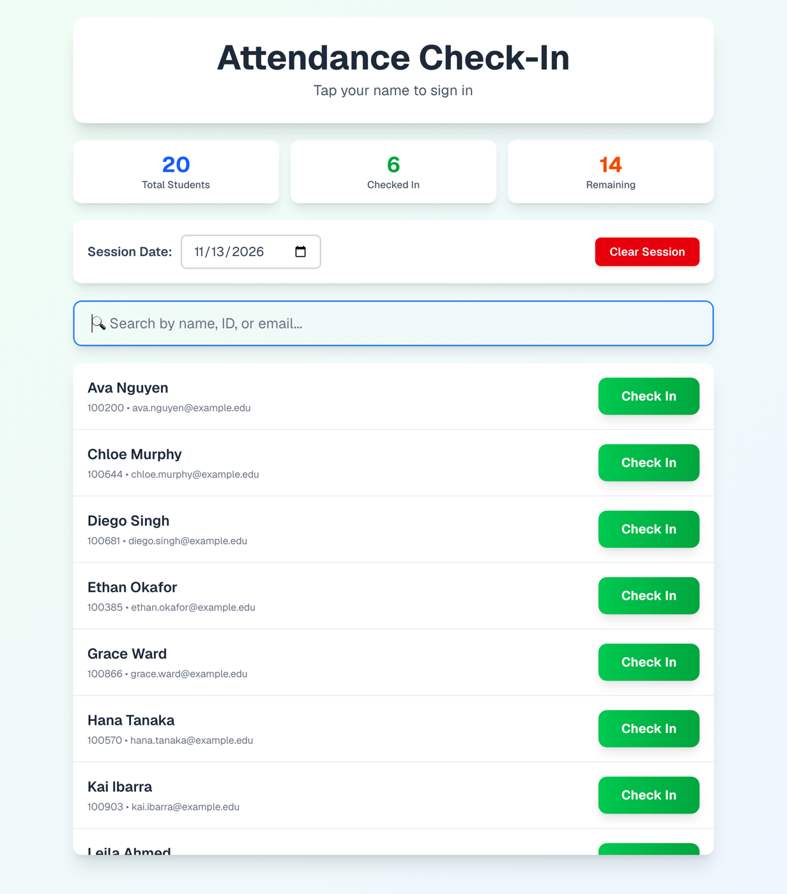
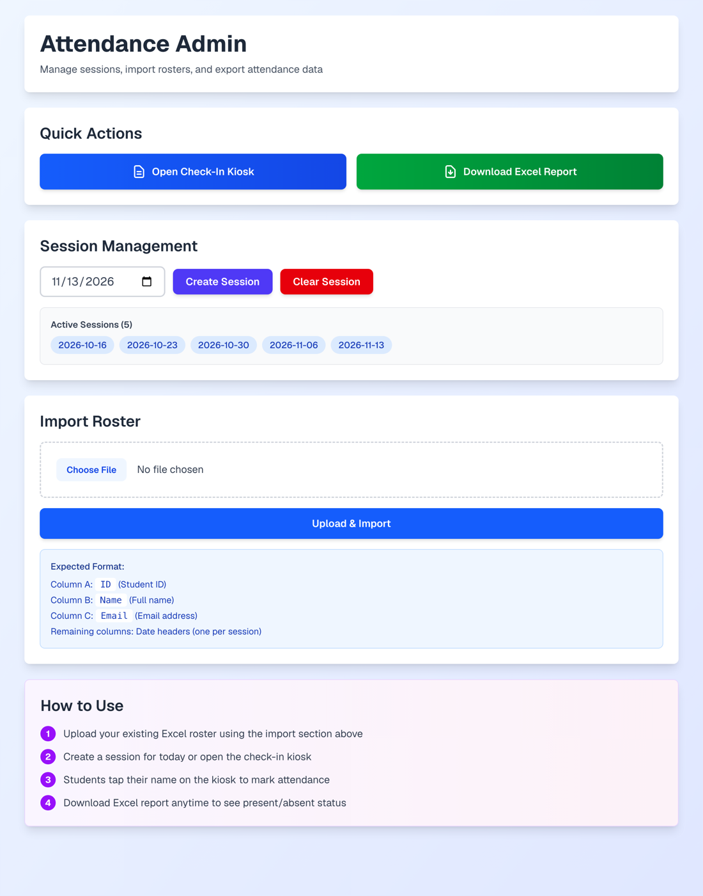

# Attendance Tracker

[](https://github.com/JonathanSContreras/attendance-tracker/actions/workflows/ci.yml)


A self-service check-in kiosk for classroom attendance. Students find their name on a tablet by the door and tap **Check In**. The instructor gets an Excel sheet with present/absent marks for every class meeting.

I built it while working as a TA for an intro course. The professor wanted attendance taken on paper and typed into a spreadsheet afterward. This replaced both steps, and because it reads and writes the same spreadsheet layout, the professor's existing workflow didn't have to change.

| Check-in kiosk | Admin dashboard |
| --- | --- |
|  |  |

<sub>Screenshots use the fictional demo roster from `npm run db:seed`.</sub>

## Features

**Kiosk** (`/kiosk`)
- Search the roster by name, student ID, or email as you type
- Large touch targets for tablets, haptic feedback where supported
- Live counts of total, checked-in, and remaining students
- Students who have checked in drop to the bottom, most recent first, with an **Undo** button for mis-taps
- The search box clears after each check-in, ready for the next student in line

**Admin dashboard** (`/`)
- Import a roster from `.xlsx`/`.xls`, including historical attendance columns
- Create or clear sessions by date
- Export a spreadsheet with one row per student and one present/absent column per session

## Tech stack

- **Next.js 15** (App Router, Route Handlers) with **React 19** and **TypeScript**
- **Prisma** ORM on **SQLite**
- **Tailwind CSS 4**
- **SheetJS** for reading and writing Excel files
- **GitHub Actions** CI: lint, type-check, migrate, seed, and production build

## Getting started

Requires Node.js 18.18 or newer.

```bash
git clone https://github.com/JonathanSContreras/attendance-tracker.git
cd attendance-tracker
npm install
cp .env.example .env
npx prisma migrate dev   # creates prisma/dev.db
npm run db:seed          # optional: 20 fictional students and 4 past sessions
npm run dev
```

Then open the admin dashboard at <http://localhost:3000> and the kiosk at <http://localhost:3000/kiosk>.

### Roster format

The first sheet of the workbook is read. Headers are matched case-insensitively.

| ID | Name | Email | 2025-09-01 | 9/8/25 | … |
| --- | --- | --- | --- | --- | --- |
| 100200 | Ava Nguyen | ava.nguyen@example.edu | present | x | |

`ID`, `Name`, and `Email` are required. Any other column whose header is a date (ISO, `M/D/YY`, or a real Excel date cell) is imported as a past session. In those columns, `present`, `p`, `x`, `y`, `yes`, and `1` count as present; anything else counts as absent. Re-importing updates existing students by email instead of duplicating them. The export uses this same layout, so an exported sheet can be imported again.

## How it works

```
src/
├── app/
│   ├── page.tsx              Admin dashboard
│   ├── kiosk/page.tsx        Check-in kiosk
│   └── api/
│       ├── roster/           GET    all students
│       ├── sessions/         GET    list sessions · POST create one
│       ├── checkin/          POST   check in · DELETE undo
│       ├── checkins/         GET    student IDs checked in on a date
│       ├── clear/            POST   delete a session and its check-ins
│       ├── import/           POST   upload a roster workbook
│       └── export/           GET    download the attendance workbook
└── lib/
    ├── db.ts                 Prisma client singleton
    └── dates.ts              Calendar-day helpers shared by client and server
prisma/
├── schema.prisma             Student, Session, Checkin
├── migrations/
└── seed.mjs                  Fictional demo data
```

The data model has three tables: `Student`, `Session` (one row per class day), and `Checkin`, which joins them.

A few design decisions:

- **No double check-ins.** `Checkin` has a unique constraint on `(studentId, sessionId)`. The API inserts and treats a unique violation (`P2002`) as "already checked in", so two quick taps on the same name can't both succeed.
- **Sessions are calendar days.** The client sends dates as `YYYY-MM-DD` strings, and the server stores each one as local midnight. An earlier version used `toISOString()`, which made evening classes in US timezones record attendance on the next day. Import handles the same issue for Excel serial dates and ISO headers.
- **Imports run in one transaction.** A malformed row partway through a roster leaves the database unchanged.

## Limitations and next steps

- **No authentication.** The app is designed for one instructor on a trusted local network. Before deploying it publicly, the admin routes and `/api/clear` need to sit behind a login.
- **SQLite only.** This works for a single machine. Serverless hosts like Vercel need a hosted database; switching Prisma's `provider` to `postgresql` is the main change.
- **Ideas:** QR-code check-in from students' own phones, multiple courses per instructor, and attendance trend reports.

## License

[MIT](LICENSE)
